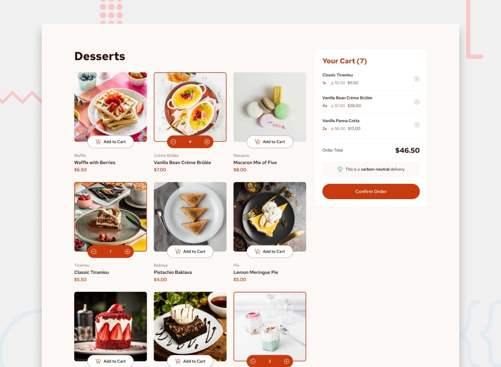

# Frontend Mentor - Product list with cart solution

This is a solution to the [Product list with cart challenge on Frontend Mentor](https://www.frontendmentor.io/challenges/product-list-with-cart-5MmqLVAp_d). Frontend Mentor challenges help you improve your coding skills by building realistic projects.

## Table of contents

- [Overview](#overview)
  - [The challenge](#the-challenge)
  - [Screenshot](#screenshot)
  - [Links](#links)
- [My process](#my-process)
  - [Built with](#built-with)
  - [What I learned](#what-i-learned)
  - [Continued development](#continued-development)
- [Author](#author)

## Overview

### The challenge

Users should be able to:

- Add items to the cart and remove them
- Increase/decrease the number of items in the cart
- See an order confirmation modal when they click "Confirm Order"
- Reset their selections when they click "Start New Order"
- View the optimal layout for the interface depending on their device's screen size
- See hover and focus states for all interactive elements on the page

### Screenshot



### Links

- Solution URL: [Add solution URL here](https://your-solution-url.com)
- Live Site URL: [Add live site URL here](https://your-live-site-url.com)

## My process

### Built with

- Semantic HTML5 markup
- CSS custom properties
- Flexbox
- Mobile-first workflow
- Vanilla JavaScript

### What I learned

I'm particularly proud of the dynamic event handling for the "Add to Cart" buttons. I implemented a solution in pure JavaScript that efficiently associates each button with its corresponding product using the element's index in the DOM. This allows for precise and scalable cart management without a framework.

```js
function addEventListenersToButtons() {
    const addToCartButtons = document.querySelectorAll('.add-to-cart-button');
    addToCartButtons.forEach((button, index) => {
        button.addEventListener('click', () => addToCart(index));
    });
}

function addToCart(productIndex) {
    const product = allProducts[productIndex];
    const cartItem = cartItems.find(item => item.name === product.name);

    if (cartItem) {
        cartItem.quantity++;
    } else {
        cartItems.push({ ...product, quantity: 1 });
    }

    displayCart();
}
```

### Continued development

I am open to any feedback, but I would especially like to receive help in two specific areas:

1.  **UI/UX Improvement:** I want to refine the interaction of the 'Add to Cart' button. Instead of just a static button, I'd like to transform it into an interactive component that allows the user to increase or decrease the quantity of the product directly from the card.
2.  **JavaScript Modularization:** I would like to receive advice on best practices for refactoring `main.js`. My goal is to break the code into smaller, more cohesive modules (e.g., `ui.js`, `cart.js`, `events.js`) to improve organization and facilitate future maintenance.

## Author

- Website - [ecc97](https://edwcc.netlify.app/)
- Frontend Mentor - [@yourusername](https://www.frontendmentor.io/profile/ecc97)